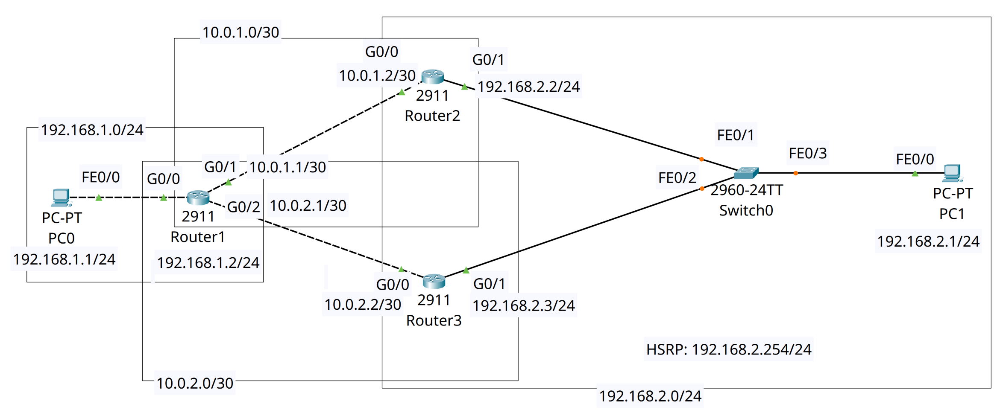

# Работа 1. Основной и резервный маршруты



[Открыть проект Packet Tracer](task1.pkt) · [Условие задания](imgs/task1.png)

Обычно пакеты между PC0 и PC1 идут через Router2. Если отключить кабель между Router1 и Router2, связь должна восстановиться через Router3.

## 1. Задать адреса компьютерам

**Desktop → IP Configuration → Static**.

| Конечное устройство | IP-адрес | Маска | Шлюз |
|---|---|---|---|
| PC0 | 192.168.1.1 | 255.255.255.0 | 192.168.1.2 |
| PC1 | 192.168.2.1 | 255.255.255.0 | 192.168.2.254 |

## 2. Настроить роутеры

**Роутер Router1.** Маршрут через Router2 основной. Число `5` в конце второго маршрута делает путь через Router3 резервным.

```text
enable
configure terminal
interface g0/0
 ip address 192.168.1.2 255.255.255.0
 no shutdown
 exit
interface g0/1
 ip address 10.0.1.1 255.255.255.252
 no shutdown
 exit
interface g0/2
 ip address 10.0.2.1 255.255.255.252
 no shutdown
 exit
ip route 192.168.2.0 255.255.255.0 10.0.1.2
ip route 192.168.2.0 255.255.255.0 10.0.2.2 5
end
write memory
```

**Роутер Router2.** Приоритет 105 делает его основным шлюзом PC1. При обрыве связи на G0/0 приоритет снижается до 95.

```text
enable
configure terminal
interface g0/0
 ip address 10.0.1.2 255.255.255.252
 no shutdown
 exit
interface g0/1
 ip address 192.168.2.2 255.255.255.0
 no shutdown
 standby 1 ip 192.168.2.254
 standby 1 priority 105
 standby 1 preempt
 standby 1 track g0/0
 exit
ip route 192.168.1.0 255.255.255.0 10.0.1.1
end
write memory
```

**Роутер Router3.** Его приоритет 100. Когда приоритет Router2 падает до 95, Router3 принимает роль активного шлюза.

```text
enable
configure terminal
interface g0/0
 ip address 10.0.2.2 255.255.255.252
 no shutdown
 exit
interface g0/1
 ip address 192.168.2.3 255.255.255.0
 no shutdown
 standby 1 ip 192.168.2.254
 standby 1 priority 100
 standby 1 preempt
 standby 1 track g0/0
 exit
ip route 192.168.1.0 255.255.255.0 10.0.2.1
end
write memory
```

## 3. Проверить переключение

1. На **PC0** выполнить `ping 192.168.2.1` и `tracert 192.168.2.1`. PC1 должен ответить, а в пути после Router1 должен быть Router2.
2. На **Router1** отключить линию к Router2.

   ```text
   configure terminal
   interface g0/1
    shutdown
   end
   ```

3. После переключения повторить обе команды на PC0. Связь должна восстановиться, а путь пройти через Router3.
4. На Router1 повторить блок из шага 2 с командой `no shutdown` вместо `shutdown`. После восстановления линии снова проверить путь.
