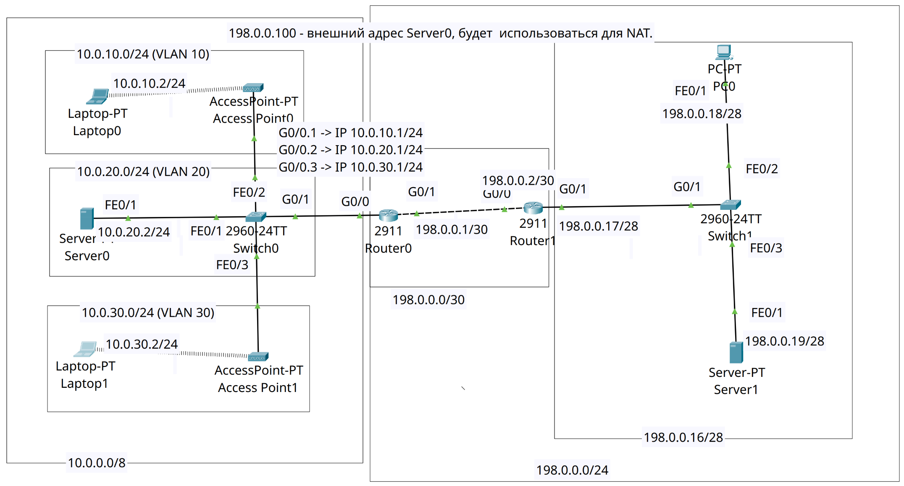

# Работа 2. Wi-Fi, доступ в Internet и защита подсети



[Открыть проект Packet Tracer](task2.pkt) · [Условие задания](imgs/task2.png)

Ноутбуки и Server0 должны выходить во внешнюю сеть. Извне Server0 должен открываться по адресу `198.0.0.100`. Для Laptop0 закрываем доступ к сети Laptop1.

## 1. Подключить Wi-Fi и задать адреса

На ноутбуках выберите сети своих точек доступа в **Desktop → PC Wireless**. Адреса задайте через **Desktop → IP Configuration → Static**.

| Устройство | IP-адрес | Маска | Шлюз |
|---|---|---|---|
| Laptop0 | 10.0.10.2 | 255.255.255.0 | 10.0.10.1 |
| Server0 | 10.0.20.2 | 255.255.255.0 | 10.0.20.1 |
| Laptop1 | 10.0.30.2 | 255.255.255.0 | 10.0.30.1 |
| PC0 | 198.0.0.18 | 255.255.255.240 | 198.0.0.17 |
| Server1 | 198.0.0.19 | 255.255.255.240 | 198.0.0.17 |

## 2. Настроить коммутатор Switch0

Создаём три VLAN и разрешаем их на trunk к Router0.

```text
enable
configure terminal
vlan 10
 exit
vlan 20
 exit
vlan 30
 exit
interface fa0/1
 switchport mode access
 switchport access vlan 20
 exit
interface fa0/2
 switchport mode access
 switchport access vlan 10
 exit
interface fa0/3
 switchport mode access
 switchport access vlan 30
 exit
interface g0/1
 switchport mode trunk
 switchport trunk allowed vlan 10,20,30
end
write memory
```

## 3. Настроить роутер Router0

Задаём шлюз для каждой VLAN. ACL 100 блокирует пакеты из сети Laptop0 в сеть Laptop1 и пропускает остальные.

```text
enable
configure terminal
access-list 100 deny ip 10.0.10.0 0.0.0.255 10.0.30.0 0.0.0.255
access-list 100 permit ip any any
interface g0/0
 no shutdown
 exit
interface g0/0.1
 encapsulation dot1Q 10
 ip address 10.0.10.1 255.255.255.0
 ip nat inside
 ip access-group 100 in
 exit
interface g0/0.2
 encapsulation dot1Q 20
 ip address 10.0.20.1 255.255.255.0
 ip nat inside
 exit
interface g0/0.3
 encapsulation dot1Q 30
 ip address 10.0.30.1 255.255.255.0
 ip nat inside
 exit
interface g0/1
 ip address 198.0.0.1 255.255.255.252
 ip nat outside
 no shutdown
 exit
```

Для ноутбуков используем один внешний адрес интерфейса G0/1 (PAT). За Server0 закрепляем отдельный адрес `198.0.0.100` (статический NAT). Пакеты в неизвестные сети отправляем на Router1.

```text
access-list 1 permit 10.0.10.0 0.0.0.255
access-list 1 permit 10.0.30.0 0.0.0.255
ip nat inside source list 1 interface g0/1 overload
ip nat inside source static 10.0.20.2 198.0.0.100
ip route 0.0.0.0 0.0.0.0 198.0.0.2
end
write memory
```

## 4. Настроить роутер Router1

Задаём IP-адреса портов и маршрут к внешнему адресу Server0 через Router0.

```text
enable
configure terminal
interface g0/0
 ip address 198.0.0.2 255.255.255.252
 no shutdown
 exit
interface g0/1
 ip address 198.0.0.17 255.255.255.240
 no shutdown
 exit
ip route 198.0.0.100 255.255.255.255 198.0.0.1
end
write memory
```

## 5. Проверить результат

| Где | Что сделать | Что должно получиться |
|---|---|---|
| Коммутатор Switch0 | `show vlan brief` и `show interfaces trunk` | Fa0/1 в VLAN 20, Fa0/2 в VLAN 10, Fa0/3 в VLAN 30. На G0/1 разрешены все три VLAN. |
| Laptop0, Laptop1 и Server0 | С каждого выполнить `ping 198.0.0.18` и `ping 198.0.0.19` | Оба внешних устройства отвечают. |
| Laptop0 | `ping 10.0.20.2`, затем `ping 10.0.30.2` | Server0 отвечает. Ответ от Laptop1 не приходит. |
| Роутер Router0 | После этих проверок выполнить `show access-lists` и `show ip nat translations` | У правила запрета есть совпадения. Для ноутбуков внешний адрес — 198.0.0.1, для Server0 — 198.0.0.100. |
| Внешний ПК PC0 | В **Desktop → Web Browser** открыть `http://198.0.0.100` | Открывается страница внутреннего Server0. |
