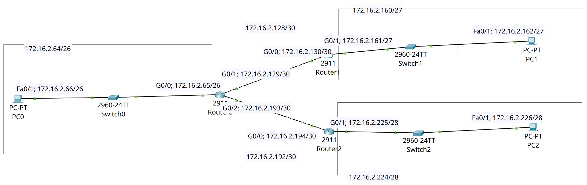

# Работа 3. Разбиение на подсети и статическая маршрутизация



[Проект Packet Tracer](task3.pkt) · [Условие задания](imgs/task3.png)

## Адреса компьютеров

| Устройство | Подсеть | Доступно адресов | IP-адрес | Маска | Шлюз |
|---|---|---:|---|---|---|
| PC0 | 172.16.2.64/26 | 62 | 172.16.2.66 | 255.255.255.192 | 172.16.2.65 |
| PC1 | 172.16.2.160/27 | 30 | 172.16.2.162 | 255.255.255.224 | 172.16.2.161 |
| PC2 | 172.16.2.224/28 | 14 | 172.16.2.226 | 255.255.255.240 | 172.16.2.225 |

## Router0

Задаём адрес шлюза PC0 и адреса двух линий между роутерами. Добавляем маршруты к сетям PC1 и PC2 через соответствующие роутеры.

```text
enable
configure terminal
interface g0/0
 ip address 172.16.2.65 255.255.255.192
 no shutdown
 exit
interface g0/1
 ip address 172.16.2.129 255.255.255.252
 no shutdown
 exit
interface g0/2
 ip address 172.16.2.193 255.255.255.252
 no shutdown
 exit
ip route 172.16.2.160 255.255.255.224 172.16.2.130
ip route 172.16.2.224 255.255.255.240 172.16.2.194
end
write memory
```

## Router1

Задаём адрес шлюза PC1. Пакеты к сетям PC0 и PC2 отправляем на Router0.

```text
enable
configure terminal
interface g0/0
 ip address 172.16.2.130 255.255.255.252
 no shutdown
 exit
interface g0/1
 ip address 172.16.2.161 255.255.255.224
 no shutdown
 exit
ip route 172.16.2.64 255.255.255.192 172.16.2.129
ip route 172.16.2.224 255.255.255.240 172.16.2.129
end
write memory
```

## Router2

Задаём адрес шлюза PC2. Пакеты к сетям PC0 и PC1 отправляем на Router0.

```text
enable
configure terminal
interface g0/0
 ip address 172.16.2.194 255.255.255.252
 no shutdown
 exit
interface g0/1
 ip address 172.16.2.225 255.255.255.240
 no shutdown
 exit
ip route 172.16.2.64 255.255.255.192 172.16.2.193
ip route 172.16.2.160 255.255.255.224 172.16.2.193
end
write memory
```

## Проверка

**На каждом роутере** проверяем состояние портов и наличие статических маршрутов (строки с буквой `S`).

```text
show ip interface brief
show ip route
```

**На PC0** проверяем связь с PC1 и PC2.

```text
ping 172.16.2.162
ping 172.16.2.226
```

**На PC1** проверяем связь с PC2 через Router0.

```text
ping 172.16.2.226
```
