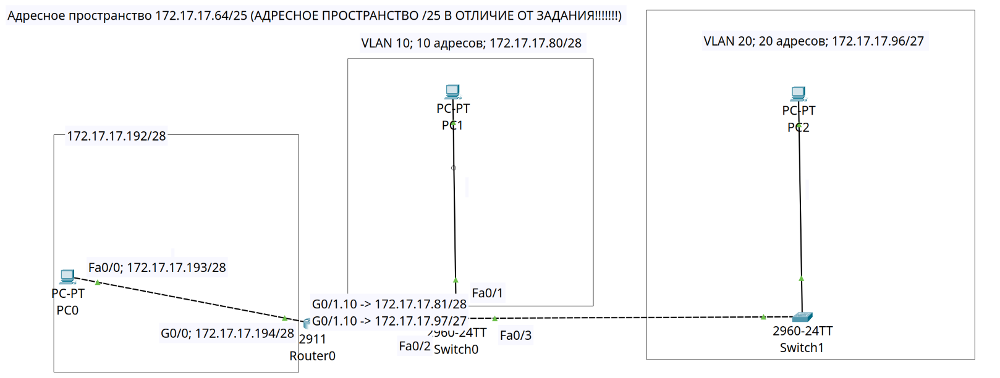

# Работа 4. VLAN и выдача адресов по DHCP



[Проект Packet Tracer](task4.pkt) · [Условие задания](imgs/task4.png)

PC0 использует статический адрес. PC1 и PC2 получают адреса из отдельных DHCP-пулов на Router0.

| Устройство | VLAN | Подсеть | IP-адрес | Шлюз |
|---|---|---|---|---|
| PC0 | — | 172.17.17.192/28 | 172.17.17.193, статический | 172.17.17.194 |
| PC1 | 10 | 172.17.17.80/28 | DHCP, на скриншоте 172.17.17.82 | 172.17.17.81 |
| PC2 | 20 | 172.17.17.96/27 | DHCP | 172.17.17.97 |

Все три подсети входят в `172.17.17.0/24`. Подпись `172.17.17.64/25` на схеме относится к сети `172.17.17.0/25`, в которую подсеть PC0 не входит. В командах использованы адреса устройств со схемы.

## Switch0 — VLAN и trunk

Создаём VLAN 10 и 20. Fa0/1 работает в VLAN 10. Trunk на Fa0/2 передаёт обе VLAN на Router0, а trunk на Fa0/3 передаёт VLAN 20 на Switch1.

```text
enable
configure terminal
vlan 10
 exit
vlan 20
 exit
interface fa0/1
 switchport mode access
 switchport access vlan 10
 exit
interface fa0/2
 switchport mode trunk
 switchport trunk allowed vlan 10,20
 exit
interface fa0/3
 switchport mode trunk
 switchport trunk allowed vlan 20
 exit
end
write memory
```

## Switch1 — VLAN 20

Настраиваем порт PC2 в VLAN 20 и разрешаем VLAN 20 на trunk к Switch0. Номера портов Switch1 на схеме не подписаны. В командах подставьте номера из проекта.

```text
enable
configure terminal
vlan 20
 exit
interface <порт PC2>
 switchport mode access
 switchport access vlan 20
 exit
interface <порт к Switch0>
 switchport mode trunk
 switchport trunk allowed vlan 20
 exit
end
write memory
```

## Router0 — шлюзы для трёх подсетей

На G0/0 задаём шлюз PC0. На G0/1 создаём отдельный подынтерфейс для каждой VLAN. На схеме оба подписаны как G0/1.10. В командах используем G0/1.10 для VLAN 10 и G0/1.20 для VLAN 20.

```text
enable
configure terminal
interface g0/0
 ip address 172.17.17.194 255.255.255.240
 no shutdown
 exit
interface g0/1
 no shutdown
 exit
interface g0/1.10
 encapsulation dot1Q 10
 ip address 172.17.17.81 255.255.255.240
 exit
interface g0/1.20
 encapsulation dot1Q 20
 ip address 172.17.17.97 255.255.255.224
 exit
```

## Router0 — DHCP для VLAN 10 и 20

Исключаем адреса шлюзов из выдачи. Для VLAN 10 остаются адреса `172.17.17.82–172.17.17.94`, для VLAN 20 — `172.17.17.98–172.17.17.126`.

```text
ip dhcp excluded-address 172.17.17.81
ip dhcp excluded-address 172.17.17.97
ip dhcp pool VLAN10
 network 172.17.17.80 255.255.255.240
 default-router 172.17.17.81
 exit
ip dhcp pool VLAN20
 network 172.17.17.96 255.255.255.224
 default-router 172.17.17.97
 exit
end
write memory
```

## Настройки компьютеров

На PC0 задаём статический адрес из таблицы с маской `255.255.255.240`. На PC1 и PC2 выбираем DHCP.


## Проверка

**Switch0 и Switch1.** Смотрим VLAN доступа и разрешённые VLAN на trunk.

```text
show vlan brief
show interfaces trunk
```

**Router0.** Проверяем адреса, выданные из двух пулов.

```text
show ip dhcp binding
```

**PC0.** Проверяем связь с PC1 и PC2. Во второй команде подставляем фактический адрес PC2 из таблицы DHCP.

```text
ping 172.17.17.82
ping <IP-адрес PC2>
```

**PC1.** Проверяем связь с PC2 через Router0.

```text
ping <IP-адрес PC2>
```
