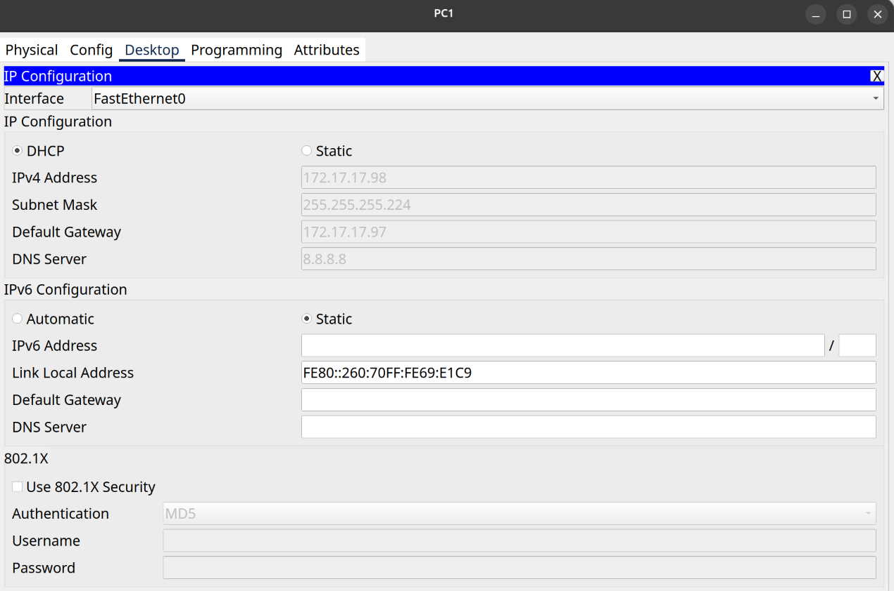
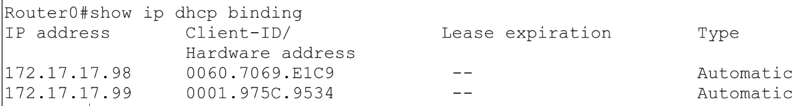

# Работа 4. Выдача IP-адресов по DHCP


[Проект Packet Tracer](task4.pkt) · [Условие задания](imgs/task4.png)

PC0 использует статический адрес в сети `172.17.17.80/28`. PC1 и PC2 находятся в общей сети `172.17.17.96/27` и получают адреса от Router0. Обе подсети входят в диапазон `172.17.17.64/26`.

## Router0 — адреса интерфейсов

Задаём шлюз `172.17.17.81` для PC0 и `172.17.17.97` для PC1 и PC2. Обе сети подключены к одному роутеру напрямую, поэтому статические маршруты не нужны.

```text
enable
configure terminal
interface g0/0
 ip address 172.17.17.81 255.255.255.240
 no shutdown
 exit
interface g0/1
 ip address 172.17.17.97 255.255.255.224
 no shutdown
 exit
```

## Router0 — DHCP для PC1 и PC2

Исключаем адрес шлюза из выдачи. В пуле задаём сеть, шлюз и DNS. Клиентам доступны адреса от `172.17.17.98` до `172.17.17.126`.

```text
ip dhcp excluded-address 172.17.17.97
ip dhcp pool LAN0
 network 172.17.17.96 255.255.255.224
 default-router 172.17.17.97
 dns-server 8.8.8.8
 exit
end
write memory
```

## Настройка компа



## Проверка

**Router0.** Проверяем, какие адреса выдал DHCP. На скриншоте выданы `172.17.17.98` и `172.17.17.99`.

```text
show ip dhcp binding
```



**PC0.** Проверяем связь с обоими DHCP-клиентами по адресам из таблицы.

```text
ping 172.17.17.98
ping 172.17.17.99
```

**PC1.** Проверяем связь с PC2. Если DHCP выдал другие адреса, подставляем текущий адрес PC2.

```text
ping 172.17.17.99
```
